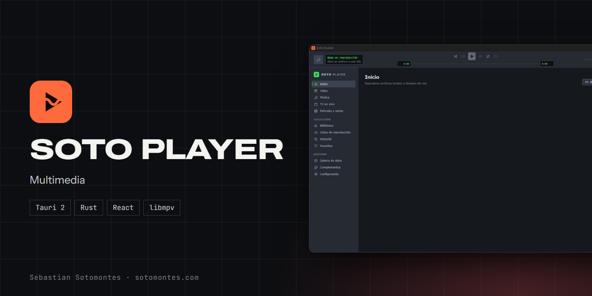
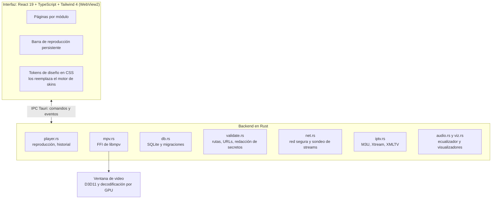

Plataforma multimedia para Windows: video, música, streams de red y TV en vivo en una sola app, con skins y complementos.

<a href="https://sotomontes.com/#soto-player"><b>Ver en sotomontes.com</b></a> · <a href="#cómo-se-usa">Cómo se usa</a> · <a href="#cómo-funciona-por-dentro">Cómo funciona</a> · <a href="#novedades">Novedades</a>

| Ficha técnica | |
|---|---|
| **Autor** | Sebastian Sotomontes |
| **Tipo** | Multimedia |
| **Plataforma** | Windows 10 y 11 |
| **Versión** | 0.1.0 |
| **Estado** | Funcional |
| **Stack** | Tauri 2 · Rust · React · libmpv |
| **Código** | Privado. Esta página es solo una presentación. |

---

## Qué es

SOTO PLAYER reúne en una sola aplicación todo lo que normalmente necesita varios programas: video, música, radio y streams de red, y televisión en vivo. Reproduce casi cualquier formato con decodificación por GPU, recuerda dónde te quedaste y se puede transformar por completo con skins.

## Novedades

- Complementos de catálogo con películas, series, fuentes y subtítulos.
- Internet Archive integrado, con contenido de dominio público y Creative Commons.
- Menú contextual con submenús de audio, subtítulos y velocidad.
- Complementos aislados con permisos y pruebas de rendimiento.

## Cómo se usa

1. Abre la aplicación y pulsa **Abrir archivo** o **Abrir URL**. También puedes usar «Abrir con…» desde Windows.
2. Usa la barra superior para reproducir, pausar, cambiar la velocidad, activar el modo aleatorio o repetir. Al abrir un archivo, el resto de su carpeta queda en cola.
3. Vuelve a **Inicio** para retomar lo que dejaste a medias, en el punto exacto.
4. En **Biblioteca** organiza tu música, y en **Películas y series** tu catálogo. Crea listas de reproducción y marca favoritos.
5. En **TV en vivo** carga tu lista M3U o tu cuenta Xtream y consulta la guía de programación.
6. En **Galería de skins** cambia el aspecto del reproductor o crea uno propio con el editor, y añade fuentes en **Complementos**.

## Funciones

- **Video y música** locales o de red, con motor libmpv, ecualizador, visualizadores y listas.
- **TV en vivo** por IPTV: listas M3U, Xtream y guía de programación EPG.
- **Biblioteca y catálogo** de películas y series, con historial y favoritos.
- **Skins** con formato propio `.sotoskin`, galería y editor.
- **Complementos** para ampliar las fuentes y funciones.

## Detalles

- Ecualizador y visualizadores para la música.
- Formato de skins propio `.sotoskin`.
- Las URL con usuario y contraseña no se guardan en el historial.
- Versión instalable y versión portable.

## Cómo funciona por dentro

### Arquitectura

### Video dentro de la ventana

libmpv recibe la ventana principal y crea una ventana hija donde dibuja con `gpu-next` sobre D3D11, con decodificación por GPU. La ventana de Tauri es transparente y el WebView2 queda encima, así que en la vista de video solo se pintan los controles sobre la imagen.

### Estado del reproductor

El backend observa las propiedades de mpv (posición, duración, pausa, volumen, velocidad, título) y publica un estado completo por evento, limitado a 5 actualizaciones por segundo. La interfaz no guarda un estado propio del motor: refleja el que llega.

### Historial y continuar

Se guarda la posición al abrir, cada 5 segundos, al cambiar de medio y al salir. Un medio se retoma si se vio más de 5 segundos, no se terminó y su duración es conocida, por eso los streams en vivo no se reanudan.

### Cola de reproducción

Lista, orden de reproducción (normal o aleatorio con el medio actual primero) y posición. Abrir un archivo local encola el resto de su carpeta en orden natural.

### Ecualizador

10 bandas ISO de 31 Hz a 16 kHz, con preamplificación y normalización, aplicadas como filtros de audio dentro de mpv, con un rango de ±12 dB. Se comprobó de extremo a extremo midiendo la señal capturada.

### Visualizadores

Captura por WASAPI solo el audio de SOTO PLAYER, después del ecualizador. Una FFT Hann de 2048 puntos genera 64 bandas logarítmicas y la forma de onda, a unas 40 tramas por segundo. Modos: barras, onda, circular, frecuencias, partículas y cascada. La captura solo corre mientras alguna vista la usa.

### Red y streaming

Toda petición del backend resuelve el DNS y rechaza direcciones no públicas, salvo que la fuente permita la red local. Las redirecciones se siguen a mano, revisando cada salto, y el cuerpo se limita en bytes. Antes de reproducir se clasifica el contenido (HLS, DASH, progresivo, RTSP/RTMP, lista M3U o página web) por cabecera, extensión y firma.

### IPTV

- **M3U:** atributos `tvg-id`, `tvg-name`, `tvg-logo` y grupos, hasta 200 000 canales.
- **Guía XMLTV:** lectura en streaming, con gzip detectado por firma.
- **Xtream:** la cuenta se valida antes de guardarse. Usuario y contraseña van al Administrador de credenciales de Windows; la base de datos no los contiene. Los canales protegidos se abren sin historial ni registros.

### Biblioteca y catálogo

El escaneo es incremental: compara tamaño y fecha, y solo relee lo cambiado. Una segunda instancia de libmpv sin ventana extrae una miniatura y lee duración, códecs y pistas. Los nombres se clasifican solos: `S01E02`, `1x02` o carpetas de temporada son episodios; un año antes de las etiquetas técnicas o 60 minutos o más indican película. Los duplicados se detectan por una huella de tamaño y primeros y últimos 64 KB.

### Seguridad

- A mpv solo llegan archivos existentes con extensión multimedia o URLs `http`, `https`, `rtsp`, `rtmp` y `rtmps`.
- mpv arranca sin leer configuración ni scripts del usuario, y no ejecuta programas externos.
- Los registros eliminan credenciales de las URLs.
- Política de seguridad de contenido estricta en la interfaz y permisos mínimos de Tauri.

**Créditos:** usa libmpv.

---

© 2026 Sebastian Sotomontes. Todos los derechos reservados.
