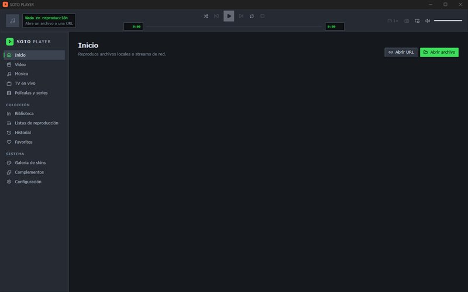

<h1 align="center">SOTO PLAYER</h1>

Plataforma multimedia para Windows: video, música, streams de red y TV en vivo en una sola app, con skins y complementos.

<a href="https://sotomontes.com/#soto-player"><b>Ver en sotomontes.com</b></a>

**Autor:** Sebastian Sotomontes · © 2026

> Esta página es solo una presentación del proyecto. El código y los instaladores son privados.

---

## Funciones

- **Video y música** locales o de red, con motor libmpv, ecualizador, visualizadores y listas.
- **TV en vivo** por IPTV: listas M3U, Xtream y guía de programación EPG.
- **Biblioteca y catálogo** de películas y series, con historial y favoritos.
- **Skins** con formato propio `.sotoskin`, galería y editor.
- **Complementos** para ampliar las fuentes y funciones.

## Tecnologías

Tauri 2 · Rust · React · libmpv

**Créditos:** usa libmpv.

© 2026 Sebastian Sotomontes. Todos los derechos reservados.
